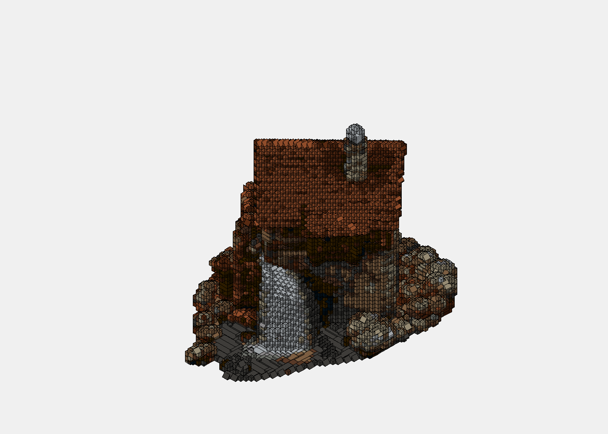
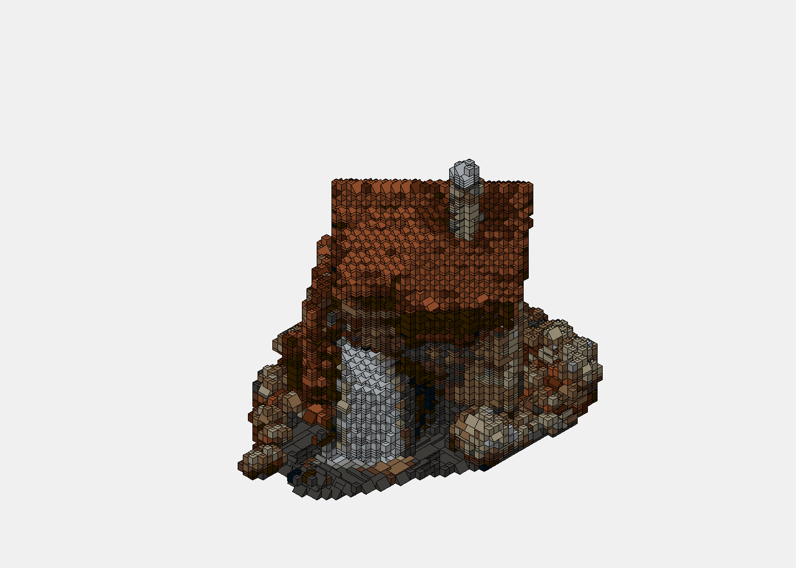

# everything2lego

Convert a 3D mesh, a set of turntable images, or a single photo into a
buildable LEGO model — a `.ldr` file, a parts list (`wanted.xml`), an offline
3D viewer, illustrated PDF instructions, and a preview render.

The pipeline goes **photo → 3D → LEGO**, so any of the three stages can be
skipped:

```
photo  ──►  Hunyuan3D  ──►  colored mesh  ──►  semantic pipeline  ──►  LEGO
       (or TripoSR / DUSt3R / silhouette carving)                       ├─ .ldr
                                                                        ├─ wanted.xml
                                                                        ├─ viewer/
                                                                        ├─ instructions.pdf
                                                                        └─ preview.png
```

<p align="center">


</p>

<p align="center"><em>Left: watermill at 80 studs (38K parts, very detailed).
Right: same watermill at 56 studs with hollow interior (12K parts, still
recognizable).  Both were reconstructed from one photo via Hunyuan3D-2mini,
then passed through the semantic + soft-train pipeline.</em></p>

---

## Install

Requires Python 3.9+.  On Apple Silicon the neural backends need an
`x86_64` venv with Rosetta 2 installed (`softwareupdate --install-rosetta`)
because PyTorch's Hunyuan/TripoSR builds are still Intel-only for some ops.

```bash
python3 -m venv .venv
.venv/bin/python -m pip install -e '.[dev]'
```

That installs the core mesh → LEGO pipeline plus `pytest`.  Nothing in it
needs a GPU or PyTorch, so it works on a plain CI runner; the tests that
touch the neural backends skip themselves when torch is absent.

Extras (combine as `'.[dev,neural]'`):

| extra    | what it adds                                                       |
|----------|--------------------------------------------------------------------|
| `dev`    | `pytest` — enough to run the whole suite                            |
| `neural` | torch, torchvision, diffusers, transformers, einops, omegaconf, timm, scikit-image, opencv-python-headless, onnxruntime, scikit-learn, pymeshlab, pyyaml — the photo → 3D backends (Hunyuan3D, TripoSR, DUSt3R, U^2-Net) |

```bash
.venv/bin/python -m pip install -e '.[dev,neural]'
```

The interactive viewer's JavaScript bundle (`src/everything2lego/viewer/bundle.js`)
is committed, so Node is only needed when you change `main.js`:

```bash
npm ci                    # three.js, lucide, esbuild, Playwright
npm run build:viewer      # regenerate bundle.js (commit the result)
```

External model checkpoints (~1.5 GB each) live on a directory you point at
with environment variables — put them on an external disk if internal SSD
is tight:

```bash
export HF_HOME=/Volumes/PRO-G40/huggingface
export TORCH_HOME=/Volumes/PRO-G40/torch
export HY3DGEN_MODELS=/Volumes/PRO-G40/hy3dgen
```

---

## Quick start

### Pure LEGO pipeline (mesh you already have)

```bash
.venv/bin/everything2lego semantic examples/sample.glb \
    --out out/ --max-studs 56 --soft-train
```

### Photo → 3D → LEGO

```bash
# 1) Photo to mesh (Hunyuan3D-2mini, best on 16 GB Apple Silicon).
HUNYUAN3D_REPO=tencent/Hunyuan3D-2mini \
HUNYUAN3D_SUBFOLDER=hunyuan3d-dit-v2-mini \
PYTORCH_ENABLE_MPS_FALLBACK=1 \
.venv/bin/everything2lego hunyuan photo.jpg \
    --out out_mesh/ --resolution 384 --steps 50 --guidance 7.5

# 2) Preprocess the mesh so the LEGO pipeline packs cleanly:
.venv/bin/python tools/bake_texture_to_vertex.py     out_mesh/model.glb out_mesh/baked.glb
.venv/bin/python tools/decimate_keep_color.py        out_mesh/baked.glb out_mesh/dec.glb 60000
.venv/bin/python tools/quantise_colors.py            out_mesh/dec.glb   out_mesh/q.glb 8

# 3) LEGO pipeline with all quality improvements enabled.
.venv/bin/everything2lego semantic out_mesh/q.glb \
    --out out_lego/ --max-studs 56 \
    --subvoxels 2 --hollow \
    --soft-train --soft-iters 500 --w-color 3.0
```

### Silhouette hull from turntable images (no neural net)

```bash
.venv/bin/everything2lego carve examples/views --max-studs 24 --out out/
```

---

## The semantic pipeline

`semantic` runs a five-stage pipeline (see `ARCHITECTURE_V2.md`):

1. **Voxelise** the mesh at `max_studs` resolution.  `--subvoxels 2` super-
   samples occupancy for cleaner thin walls and window frames.
2. **Region detector** classifies each mesh face into a region — planar
   walls (from `trimesh.facets`), planar roofs (via normal clustering of
   leftover marching-cubes triangles), foundations, curved primitives, or
   generic detail.
3. **Per-region MILP packing** — each region calls a specialised builder
   (`PlanarWallBuilder`, `PlanarRoofBuilder`, …) which uses HiGHS to solve
   an exact-cover problem over the region's cells, picking the biggest LEGO
   plate/tile that fits.
4. **Optional soft training (`--soft-train`)** — 300 steps of Adam (set
   `--soft-iters`) over a Gumbel-Softmax-relaxed cell grid.  Needs PyTorch.  The trainer *initialises* from the
   MILP placements (idea #1), keeps per-region palette locks (idea #2) —
   a planar region (wall, roof, foundation) is locked to the fewest colours
   covering 70% of its cells, usually one; where region boxes overlap a
   cell keeps every candidate; and the colour *target* is snapped to match
   so the lock can't become pressure to empty cells —
   and includes a support term that penalises floating cells (idea #6).
   Loss = `2·shape + 1·color + 0.05·type_prior + 0.02·coherence
   + 0.05·support`.
5. **Discretise** the soft grid via a brick pre-pass (5-plate `brick_tall`
   → 3-plate `brick` → 1-plate) with vertical + horizontal colour majority
   smoothing so bigger footprints actually get consolidated.  Slopes emit
   as 2×1 slopes (part 3040) with 1×1 brick fillers for orphans; cheese
   slopes (54200) at pitched-roof tips.

### Set-design mode (`--set-mode`)

The stages above produce a quantised *surface*: whatever cells the voxel
grid holds, packed with the fewest parts.  A real LEGO set is a quantised
*design*: "this wall is 12 studs long, 5 bricks high, window at stud 4",
built in bonded courses; "this roof is six rows of 33° slopes with a ridge
of tiles".  `--set-mode` adds that layer (`semantic_v2/setdesign.py` and
`semantic_v2/massing.py`) between the voxel target and the builders.

The architecture is read off the **solid voxel volume**, not off segmented
regions: a segmenter slices a photo-reconstructed facade into a dozen
regions and a roof face into strips, while the filled voxel shell has none
of that noise — its plan at every brick course *is* the floor plan and its
top surface *is* the roof.

- **Walls** — every axis-aligned run of boundary cells of the plan, course
  by course, accumulated into one wall per plane line (the ±1-stud wobble
  of a reconstructed facade is folded onto the dominant line).  Each wall
  is built in a running bond from 1×1…1×16 bricks around its openings (the
  labeller's boxes, or windows found by colour); odd courses lead with a
  2-stud brick so the seams never stack, and two walls meeting at a corner
  alternate the corner column course by course.
- **Roofs** — patches of the height map with a steady gradient along one
  axis become pitches (eave, ridge, span, rise); slices of one face are
  merged, opposite faces across a ridge paired into a gable, the rest are
  lean-tos.  A gable is rows of slope parts stepping in per brick course
  (45° family for 1-stud steps, 33° family for 2-stud steps — 2×8 down to
  2×1, 3×6 down to 3×1), bricks in the wall colour filling the triangle at
  each end and every 8 studs between, plate strips along the inner edges so
  the next row rests on two studs, tiles across the ridge.  The roof seats
  on the eave walls; gable-end walls stop at the roof base so the triangle
  is the roof's; a part of one roof that another roof or a tower hides is
  not built.  A **hip** reads off the height map as faces pitched along
  both axes over one footprint: they collapse into one roof whose ends step
  in each row and carry slopes facing out along the ridge (half-hips when
  only one end does).
- **Floors and spines** — a plate sheet at every storey, under every roof
  (its ceiling) and under every wall that starts above the ground (the base
  plate, the sheet a set-back storey or a tower stands on), covering wall
  tops and room alike so it ties the walls; the walls build that course as
  two plates under it.  Hidden 1-stud spine walls every 8 studs carry each
  sheet, so no plate hangs.  Flat tops (a flat roof, a terrace, each tread
  of the steps) are the top floor of their block.
- **Piers** — small solid bits nobody else accounts for (a chimney, a
  pillar) are built solid, standing on the ground or a floor.
- **Sculpture** — a shape that is not a building (its plan outlines are
  staircases rather than straight runs: corner density above 0.3) gets
  none of the above.  It is built the way a set builds organic form:
  course by course, a two-stud brick shell plus whatever the course above
  stands on, bonded by alternating the packing direction; where the course
  above steps in by one stud the edge cells become 45° slopes facing out
  (two studs: 33°), where it steps out the course above gets inverted
  slopes; a base plate under the whole footprint.  `examples/sample.glb`
  (a sphere) comes out as a dome of slopes over bonded courses, one
  assembly, in the voxel colours.
- **Stand** (`--stand/--no-stand`, `--stand-color`, default on for
  figures) — a pedestal under exactly the parts of a figure's underside
  too steep for inverted slopes (where the shape widens by two or more
  studs per course), built as solid brick courses from the base plate up
  to the figure, plates at the seam.  The sphere's support columns go from
  871 to 60 with it.
- A recipe owns its volume outright, so nothing else is built through it.
  The solid volume itself is read robustly from a leaky reconstruction
  (closed shell, per-plan and x-ray fills, covered-and-bracketed interiors).
  `PipelineConfig.set_source="regions"` keeps the older path that snaps the
  detector's planar regions instead.

The structure pass then runs brace → bond → reconnect to a fixed point, and
brace columns land only on studs (never on a tile or a slope's slant).

#### A measured front (`--facade`)

A single-image generator gives the whole object, but only plausibly; a
metric depth model gives the photographed side exactly.  `tools/
facade_depth.py` runs [MapAnything](https://github.com/facebookresearch/map-anything)
(its own environment; Apache checkpoint; ~60 s on CPU) on the matted
photo and writes the metric point map of the object.  `semantic --set-mode
--facade facade.npz` then registers it to the model by ICP in isotropic
millimetres — trying every side of the model, so it also learns which way
the photo was taken — and overrides the model's front surface and skyline
column by column.  On the house photo the registration lands at 10 mm RMS
with 97 % inliers; the measured front agrees with the generator's within a
stud, but the skyline doesn't: Hunyuan had stretched the tower ~20 % above
the gable peaks, and the fused model has it at the photographed height.
Openings on the measured side come from the same data: a window or door
is a reveal — cells 0.6–2.5 studs behind the wall's face — peeled into
rectangles and snapped to frame and door parts exactly like the colour
path; colour still fills in flush glazing (a bay) where depth sees nothing.

Set mode runs *without* `--soft-train` (the trainer's discretiser re-packs
courses and undoes the bonding and slopes).  On a clean gable-house mesh it
gives one supported assembly of ~500 parts with base, bonded walls, slope
roof and ridge.

### CLI flags that matter

| Flag | What it does |
|---|---|
| `--max-studs 40..80` | LEGO grid resolution. Halving pitch drops parts ~5× and detail ~2×. |
| `--set-mode` | Build walls, roofs and the base with set-design recipes (bonded courses, slope rows, ridge tiles); see above. |
| `--subvoxels 2` | Super-sample occupancy for sharper thin features. |
| `--soft-train` | Enable the differentiable trainer; refines colour + fills gaps. |
| `--hollow` | Carve out the interior, leaving shell + floors + columns + foundation. |
| `--shell-thickness 2` | Cells kept just below the surface skin. |
| `--floor-spacing 12` | One structural floor slab every N plates. |
| `--column-spacing 8` | Column node every N × N (x, z) grid positions. |
| `--w-color 3.0` | Colour-fidelity weight. Raise when colours drift. |
| `--segmenter builtin` | CPU part segmentation (colour + normal + connectivity) instead of the facet detector. Use it on photo-reconstructed meshes. |
| `--seg-normal-degrees 25`, `--seg-min-fraction 0.01` | Builtin-segmenter cone and face-count floor. Photo-tuned CLI defaults; the library keeps 12° / 0.002 for authored meshes. |
| `--merge-small-regions 0.003` | After segmentation, fold parts under this fraction of mesh *area* into the neighbour they share the longest boundary with. Named parts (windows, doors) are kept. The face-count floor above misses area-tiny slivers on marching-cubes meshes; this catches them. |
| `--min-island 8` | Drop voxel islands smaller than this before building (floating specks). |
| `--photos path.jpg` | Compare renders of the soft model with the source photo(s): first photo is the front view, second the side, third the top. Weighted by `--w-photo-pixel` (default 1) and `--w-photo-percep` (default 0, VGG). |
| `--refine` / `--grad-refine` | Simulated-annealing and gradient refinement of the MILP placements (`--refine-iters`, `--grad-iters`). Soft training starts from their result. |
| `--milp-time 1.0` | Seconds HiGHS may spend per region. |
| `--w-shape-surface`, `--w-shape-volume`, `--w-color`, `--w-diversity`, `--w-coherence`, `--w-count` | Soft-training loss weights (defaults 1, 2, 1, 0, 0.05, 0). A support term (0.25) that penalises cells with nothing below them is always on. |
| `--n-samples` | Surface samples taken from the mesh for region detection. |

### Part labels (optional)

The region detector finds flat facets and guesses what they are from their
normals.  A part segmenter knows that a patch is a window and another a
chimney, and so does a person painting a mesh in Blender.  Either hands the
pipeline one colour per part:

```bash
# A colour-coded mesh next to the input (any segmenter, or hand-painted).
.venv/bin/everything2lego semantic house.glb --parts house.parts.glb --out out/

# No GPU: a built-in CPU segmentation by colour, normal and connectivity.
.venv/bin/everything2lego semantic house.glb --segmenter builtin --out out/
```

A JSON sidecar next to the labelled mesh (`house.parts.json`) may name the
colours: `{"#ff0000": "roof", "#0000ff": "window", "#ffff00": "door"}`.
Named windows and doors become frames and doors the walls are packed around;
unnamed parts are classified by normal and height.  Labels made on a
decimated copy of the mesh are carried back by nearest face.

[SegviGen](https://github.com/Nelipot-Lee/SegviGen) (Li et al., SIGGRAPH
2026, MIT) is the segmenter this was built for.  It needs Linux, an NVIDIA
GPU with 24 GB of memory and the TRELLIS.2 environment; `tools/segvigen.py`
drives it, caches results by mesh hash, decimates the mesh first (the model
works on a fixed voxel grid, so extra triangles only cost time) and passes a
painted 2D map through for its guided mode:

```bash
python tools/segvigen.py house.glb --segvigen ~/SegviGen --faces 50000
.venv/bin/everything2lego semantic house.glb --parts house.parts.glb
```

Without that hardware, `--segmenter builtin` and hand-painted labels give the
same pipeline its parts.  None of this is required: without `--parts` or
`--segmenter` the facet detector runs as before.

### Naming the parts with a vision model (optional)

A segmenter says where the parts are, not what they are, and the builders
only treat a part as a window, door, roof, wall or foundation when it is
named one.  Geometry can guess at a house; it cannot at a car or a chair.
`--label-parts` draws the object with each part highlighted (a PIL
rasteriser, no GPU), shows the pictures to Claude and asks what every part
is and how a LEGO builder should treat it:

```bash
pip install 'everything2lego[vlm]'        # the anthropic SDK
export ANTHROPIC_API_KEY=...

# Name the parts while building (uses --parts, or the builtin segmenter).
.venv/bin/everything2lego semantic truck.glb --label-parts --hint "a 1960s pickup" --out out/

# Or name them once, keep the result, and build from it any number of times.
.venv/bin/everything2lego label-parts truck.glb -o truck.parts.glb
.venv/bin/everything2lego semantic truck.glb --parts truck.parts.glb --out out/
```

The command prints what the model saw ("object: a pickup truck", "part 4:
windscreen -> window", "part 7: left front wheel") and keeps the renders
under `out/parts/`.  Names already in a sidecar win over the model's;
answers are cached per mesh and segmentation, so a second run is free.
One mesh costs a few cents (two overview pictures and one per part, at
most sixteen parts per request).  Requests opt into the API's default
refusal fallback, so a declined picture is retried on another model
inside the same call.  Without the package, a key or a network the
pipeline warns and carries on with unnamed parts.

### `build` styling flags

`build` (and `carve`, `triposr`, `hunyuan`...) packs voxels with the classical
packer, then runs optional post-pack passes.  `report.json` describes the
model after all of them.

| Flag | What it does |
|---|---|
| `--brace-mode auto\|floors\|columns\|none` | How floating parts get support: internal floors for hollow shells, pegs and columns otherwise. |
| `--hollow --wall-thickness 2` | Carve the interior before packing. |
| `--texture log\|masonry\|curved\|smooth` | Swap bricks for textured equivalents. |
| `--windows-color 71 --doors-color 70 --panels-color 71` | Swap stacks of bricks in those LDraw colours for window frames, doors and panels. |
| `--detect-features` | Find window- and door-shaped colour clusters and swap in real parts. |
| `--variety`, `--architectural-style` | Decorative part variation; foundation, cornice, ridge and quoin details. |
| `--color-k`, `--color-mode`, `--subvoxels` | Colour sampling and occupancy super-sampling. |
| `--max-parts N` | Target part count; picks resolution, hollowing and colour count for you (see below). |
| `--palette house\|auto\|full` | Colour handling before packing: `house` snaps to building colours, `auto` (default) clusters to `--color-clusters` (10) LDraw colours, `full` keeps every colour. |
| `--min-color-region 4` | Same-colour voxel regions smaller than this take their neighbours' majority colour, so speckles vanish. 0 disables. |

Every command exits with status 1 when the model it wrote is not one
supported assembly (see `report.json`), `--no-supports` included.

### Photo colour handling

The photo commands (`photos`, `hunyuan`, `hunyuan21`, `hunyuan-mv`,
`triposr`, `hybrid`) run `tools/delight.py` on their input photos first
when `torch` and `diffusers` are importable, so baked-in shadows and
highlights do not become colour changes in the model; without those
packages they print one line and continue.  `--no-delight` turns it off.

> **Apple Silicon / MPS:** the delight model runs in fp16 and currently
> returns an all-black image on MPS, which then paints the whole mesh black.
> Pass `--no-delight` on a Mac until that's fixed upstream.

Colours are projected from the photo onto the mesh along the camera axis.
Two kinds of vertex can't be coloured that way and are *inpainted from the
nearest vertex that could be*: faces turned clearly away from the camera
(normal · view < −0.25 — grazing surfaces like a roof seen from a drone are
still visible and keep their own sample), and faces that land on background
pixels or within 3 px of them (the mesh poking past the silhouette, and the
feathered edge a matting tool leaves).  Without this, a single-photo house
comes out with a white back wall and turret.  `tools/reproject_colors.py`
re-runs just this step on a saved mesh so colour fixes don't need another
reconstruction.

`--palette house` is the right choice for buildings: every colour snaps
(nearest CIE Lab) to white, tan, light / dark bluish grey, reddish brown,
red, dark red or black; glass snaps to trans-light-blue, or to light bluish
grey (71) when the transparent colour is not in the shipped palette.
`--palette auto` keeps the k-means-style clustering (`--color-clusters`,
default 10); `--palette full` disables quantisation.  Either way, the
per-region speckle filter (`--min-color-region`) runs afterwards.

### Part budget: `--max-parts`

```bash
.venv/bin/everything2lego carve examples/views --max-parts 1500 --out out/
```

`--max-parts N` replaces guessing at `--max-studs`.  The command packs the
model once at 16 studs (a few seconds), then predicts the part count at
every other setting with a power law calibrated on the table below and on
the carve example (parts grow like resolution^2.3 for hollow shells and
^2.5 for solids; hollowing saves ~30% at 80 studs; halving the colour count
saves ~10%).  It then picks, in order, the largest resolution, then
hollowing, then the smallest colour-count reduction that fits, and prints
the choice.  When `--max-studs` is also given, `--max-parts` wins and says
so.  Photo backends cannot be re-run cheaply, so there the budget only
lowers the resolution below the one the backend produced; `semantic`
estimates with the classical packer and leaves colours alone.

On the carve example the prediction from the 16-stud measurement (632
parts) is 1,742 at 24 studs (actual 1,601) and 3,575 at 32 studs (actual
3,550); `--max-parts 1500` chooses 20 studs and builds 1,255 parts.

### Other commands

* `optimize mesh.glb` runs the simulated-annealing optimiser on its own
  (`--iters`, `--t-start`, `--t-end`, the same `--w-*` weights).
* `demo` builds the bundled parametric templates (gable cabin, modernist
  box) for smoke tests.
* All commands write to `out/` unless `--out` says otherwise.

### Reducing part count without breaking the model

The watermill demo (`examples/gallery/`) went from 38K parts down to 5.7K
by stacking:

| Step | Parts | Loss |
|---|---|---|
| 80 studs, solid, 10-colour palette | 38,196 | 0.005 |
| `--hollow` (floors 12, columns 8) | 26,724 | 0.008 |
| 56 studs + tighter hollow | 12,598 | 0.009 |
| 40 studs + 5-colour quantisation + aggressive hollow | 5,690 | 0.009 |

Stud resolution is the biggest lever.  Then colour cluster count — fewer
clusters mean longer same-colour runs, so MILP finds bigger bricks.
Aggressive hollowing (fewer floors / columns) is the last knob — watch the
`connections` report for structural warnings if you push it hard.
`--max-parts N` (see above) walks these levers for you.

---

## Backends

| Command | Input | Backend | Notes |
|---|---|---|---|
| `build` | one textured mesh | none | classical voxel packer |
| `carve` | 2+ turntable images | silhouette hull | CPU-only, deterministic |
| `triposr` | 1 photo | Stability AI TripoSR | MPS/CUDA |
| `hybrid` | 2+ photos | TripoSR ∩ silhouettes | best classical / neural mix |
| `hunyuan` | 1 photo | Hunyuan3D-2 base / mini / mini-turbo | MPS/CUDA |
| `hunyuan-mv` | 2-4 canonical views | Hunyuan3D-2mv | MPS/CUDA |
| `hunyuan21` | 1 photo | Hunyuan3D-2.1 (bigger MoE) | needs 24+ GB VRAM |
| `photos` | 4+ unstructured photos | Naver DUSt3R | real-world subjects |
| `semantic` | any mesh | region + MILP + soft-train | **the recommended path** |

---

## Layout

```
src/everything2lego/
    bricks.py                Brick catalog (Rebrickable-derived).
    colors.py                LDraw palette + LAB nearest-neighbour matching.
    voxelize.py              Mesh → colored voxel grid.
    pack.py                  Classical greedy packer.
    pipeline.py              build/carve/… glue.
    cli.py                   Typer CLI.
    stability.py             Stud-connectivity + support checker.
    io_ldraw.py              .ldr writer.
    io_bricklink.py          wanted.xml writer.
    io_stl.py                Solid STL writer for the LEGO output.
    instructions.py          Step-by-step PDF renderer.
    viewer_export.py         Offline WebGL viewer.
    backends/                triposr, hybrid, dust3r, hunyuan3d, hunyuan3d_mv,
                             hunyuan3d_v21.
    semantic_v2/             Region detector, per-region MILP builders,
                             SoftAssembly + SoftLoss + SoftTrainer, and the
                             interior filler (with hollow support).
    templates/               Parametric template models (gable-cabin,
                             modernist-box) for tests.

tools/
    bake_texture_to_vertex.py   Bake a textured GLB into per-vertex RGB.
    decimate_keep_color.py      Quadric-decimate with KDTree colour transfer.
    quantise_colors.py          K-means in CIE LAB (near-white left out of the
                                fit); prints chroma/hue per cluster.
    reproject_colors.py         Re-run photo→vertex colour projection on a
                                saved mesh (back-face + background aware).
    remove_bg.py                U^2-Net (ONNX) foreground extraction, hard matte.
    delight.py                  Hunyuan3D-delight-v2-0 lighting removal.
    sweep_segmenter.py          One segment_builtin parameter set per run;
                                appends region count / area concentration.

examples/
    sample.glb                 A trivial mesh for `build` smoke tests.
    views/                     Turntable images for `carve`.
    gallery/                   Preview renders from the semantic pipeline.
    house/                     A cabin photo set used in the writeup.

tests/                          Pytest suite; regression tests for the packer,
                                connectivity checker, and colour matching.
```

---

## Testing

Python suite (runs without torch; the three DUSt3R tests report as
skipped unless the `neural` extra is installed):

```bash
.venv/bin/python -m pytest tests/ -q
```

Viewer smoke test — rebuilds `bundle.js` in a temp dir and checks it matches
the committed one, exports a small fixture scene with the Python package, then
drives the exported page in headless Chromium at desktop, phone and 320px
widths (orbit, step slider, auto-rotate, download links):

```bash
npm ci
npx playwright install chromium   # once; or set CHROME_PATH to a Chrome/Chromium binary
npm run test:viewer
```

The test finds the Python interpreter via `$PYTHON`, then `.venv/bin/python`,
then `python3`.  Set `VIEWER_OUT=some/dir` to keep the fixture and the
screenshots it takes.

CI (`.github/workflows/ci.yml`) runs the Python suite on 3.10 and 3.12 and the
viewer job (bundle up to date, Playwright Chromium) on every push and pull
request.

---

## Licences

MIT for our own code.  Third-party components (Hunyuan3D-2 weights, TripoSR,
DUSt3R, U^2-Net, LDraw catalogue, Rebrickable database) keep their upstream
licenses — see `LICENSE` for the list.  Hunyuan3D-2 is CC-BY-NC; commercial
use of its weights needs a separate agreement with Tencent.
